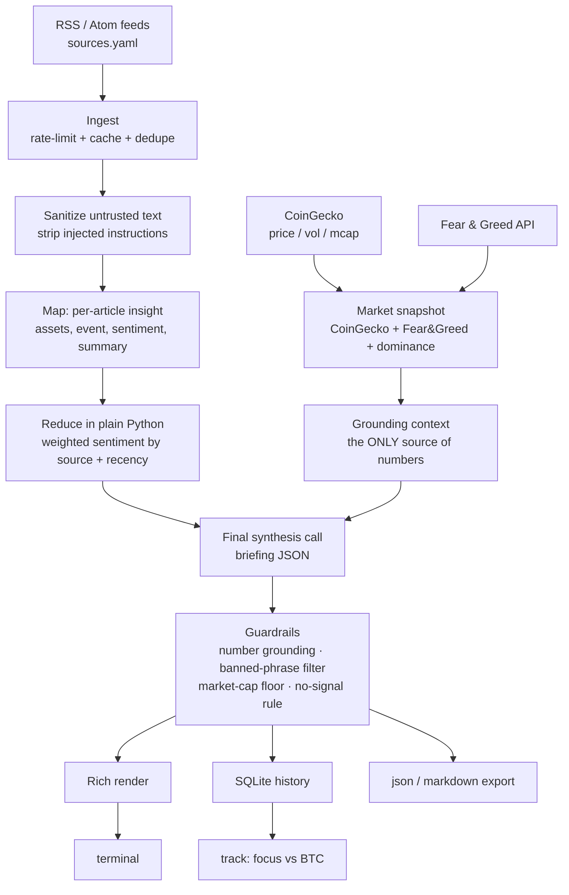

# tipsofday

**A daily crypto-market briefing, written by an open-weight LLM running entirely on your own machine.**

You run one command. The app reads today's crypto news from public feeds, fetches real
market data from public APIs, and a local model writes a short briefing: the day's mood,
the top stories, one asset with the strongest *news signal* today, the evidence, a
confidence level, the risks, and what would invalidate the call. When there is not
enough signal, it says **"No clear signal today"** instead of inventing a pick.

It never claims to know the best investment, never gives price targets, and every
briefing ends with a disclaimer. It is an information tool, not financial advice.

> **Read this first:** tipsofday does not predict prices and does not tell you what to
> buy or sell. It tells you which asset the *news flow* points at today, and shows its
> work. See [`LEGAL_NOTES.md`](LEGAL_NOTES.md).

---

## Why local, open-weight models

| | tipsofday | a cloud-AI briefing |
|---|---|---|
| Cost per briefing | **$0.00** (your electricity) | $0.001–$0.05 |
| Your watchlist & history | **never leave your PC** | sent to a vendor |
| Works offline for the AI step | **yes** (fetch needs internet) | no |
| Model can be swapped | **yes** | vendor's choice |
| Reproducible / auditable | **yes** (open weights, open code) | no |

The news fetch and the market fetch need the internet. The *thinking* does not.

---

## Quick start

### 1. Install a local model runtime

tipsofday defaults to **[Ollama](https://ollama.com)**, which is the simplest way to run
an open-weight model on Windows, macOS and Linux.

```bash
# macOS / Linux
curl -fsSL https://ollama.com/install.sh | sh

# then pull the default model (gemma4:e4b, ~6.6 GB, Apache-2.0 open weights)
ollama pull gemma4:e4b
```

Windows: download the Ollama installer from <https://ollama.com/download> and run
`ollama pull gemma4:e4b` in PowerShell.

On a low-memory machine, pull the smaller Gemma 4 tier instead
(`ollama pull gemma4:e2b`, ~4.6 GB) — `tipsofday doctor` will recommend one for you.

### 2. Install tipsofday

```bash
git clone https://github.com/tipsofday/tipsofday
cd tipsofday
pipx install .
# or, without pipx:
python3 -m venv .venv && . .venv/bin/activate && pip install -e .
```

`pipx` keeps the app isolated from your other Python tools, which is what you want for a
CLI. Python **3.11+** is required.

### 3. First run

```bash
tipsofday init      # creates ~/.config/tipsofday and a sources.yaml you can edit
tipsofday doctor    # checks hardware, model, internet and feed health
tipsofday run       # writes today's briefing
```

`tipsofday` with no subcommand does the same as `tipsofday run`.

---

## The CLI

```
tipsofday                          today's briefing (cached per day)
tipsofday run --refresh            force a new briefing
tipsofday run --lang en            English briefing (default: pt)
tipsofday run --model gemma4:12b   swap the model for this run
tipsofday run --watchlist BTC,ETH  restrict the assets considered
tipsofday run --url https://…      include your own article link
tipsofday run --json | --markdown  machine-readable / Markdown export (Pro)
tipsofday run --offline            no network; use the last cached briefing
tipsofday run --think              keep the model's hidden reasoning (slower; off by default)
tipsofday history                  past briefings
tipsofday track                    focus asset vs BTC buy-and-hold, with honest stats
tipsofday sources [--test]         list/test your feeds
tipsofday doctor                   hardware, model, internet, feed health
tipsofday activate <KEY>           activate a Pro license
tipsofday status                   plan, model, backend, pricing
tipsofday schedule --install       print the daily cron/Task Scheduler entry
tipsofday benchmark                JSON-validity + latency sanity check on your model
```

### Example

```
╭─────────────────── Resumo diario de cripto ───────────────────╮
│ 15 Oct 2026 · modelo local gemma4:e4b · 12 noticias analisadas  │
╰───────────────────────────────────────────────────────────────╯
╭──────────────────── Destaque do dia ──────────────────────────╮
│ BNB   confianca: media                                        │
│                                                               │
│ Por que                                                       │
│  · Fluxo de noticias positivo nas ultimas 24h.                │
│  · Volume 24h de $1.9B acima do piso de liquidez.             │
│                                                               │
│ Riscos                                                        │
│  · Movimento puxado por noticia pode ja estar precificado.    │
│                                                               │
│ O que invalidaria isto                                        │
│  · Virada na narrativa dominante ou dados que contradigam.    │
╰───────────────────────────────────────────────────────────────╯
```

---

## Architecture



**Design rules**

1. **Numbers come from APIs, never from the model.** Every number in the output is
   checked against the market snapshot; sentences with ungrounded numbers are dropped.
2. **Web text is data, never instructions.** Article text is sanitized and wrapped in
   delimiters before it reaches the model; a prompt-injection test set is part of CI.
3. **The pick is capped.** No micro-caps or illiquid tokens (configurable market-cap
   and volume floors) can ever become the focus asset.
4. **"No clear signal today" is a valid answer**, and the correct one when the news
   flow is thin, conflicting or negative.

---

## Swapping models

Any open-weight model that runs in Ollama works. The whole model layer sits behind one
interface (`LLMBackend`), so nothing else changes.

```bash
tipsofday run --model qwen3:8b
tipsofday run --model llama3.1:8b
tipsofday run --model gemma4:12b
```

- Change the default in `~/.config/tipsofday/config.json` (`"model": "…"`).
- `tipsofday doctor` detects your RAM/VRAM and recommends a size (the 4B-tier Gemma 4 E4B
  fits a small GPU or CPU; a 12B Q4 is comfortable with 24 GB RAM or ~10 GB VRAM).
- **llama.cpp** is supported as an alternative backend: install the extra
  (`pip install "tipsofday[llamacpp]"`), then run `--backend llamacpp --model /path/to/model.gguf`.
- The default `gemma4:e4b` was chosen with a real benchmark; see
  [`DECISIONS.md`](DECISIONS.md) and [`eval/RESULTS.md`](eval/RESULTS.md).

> **Thinking models** (Gemma 4, Qwen3 with reasoning) spend part of the token budget on
> hidden reasoning. tipsofday disables that by default (`think: false`) because it parses
> only the final JSON; pass `--think` if you want to keep the reasoning (slower).

## Adding your own news sources

```bash
tipsofday init        # writes ~/.config/tipsofday/sources.yaml
$EDITOR ~/.config/tipsofday/sources.yaml
tipsofday sources --test   # verify each feed is reachable
```

```yaml
feeds:
  - name: My Favorite Feed
    url: https://example.com/feed.xml
    lang: en            # or pt
    reliability: 0.9    # 0..1, weights the story in aggregation
    enabled: true

urls:                   # one-off article links, no feed needed
  - https://example.com/an-article-you-want-included
```

You can also pass links for a single run: `tipsofday run --url https://… --url https://…`.
Feeds that are down never break the run — they are listed in the briefing as failed
sources and the rest continues.

---

## Deploying / running daily

**cron (Linux/macOS)** — generate a fresh briefing every morning at 08:00:

```cron
0 8 * * * /home/you/.local/bin/tipsofday run --refresh >> /home/you/.local/share/tipsofday/cron.log 2>&1
```

**systemd (Linux)** — a user timer that hits the same command:

```ini
# ~/.config/systemd/user/tipsofday.service
[Unit]
Description=tipsofday daily briefing
[Service]
Type=oneshot
ExecStart=%h/.local/bin/tipsofday run --refresh
```
```ini
# ~/.config/systemd/user/tipsofday.timer
[Unit]
Description=Run tipsofday every morning
[Timer]
OnCalendar=*-*-* 08:00:00
Persistent=true
[Install]
WantedBy=timers.target
```
```bash
systemctl --user enable --now tipsofday.timer
```

**Windows Task Scheduler** — `tipsofday schedule --install` prints the exact `schtasks`
command; paste it into an elevated terminal:

```
schtasks /Create /SC DAILY /TN tipsofday /TR "tipsofday run --refresh" /ST 08:00
```

**Free hosting for a shared briefing:** the app is local-first, so "hosting" usually
means *your* machine on a schedule. If you want a public daily page, run the cron above
with `--markdown` and commit the output to a GitHub Pages repo — the export is Pro.

---

## Open-core: free vs Pro

| Feature | Free | Pro |
|---|:--:|:--:|
| 1 briefing per day | ✅ | ✅ |
| pt-BR + English | ✅ | ✅ |
| Default watchlist (top 10) | ✅ | ✅ |
| Custom watchlist & sources | – | ✅ |
| Unlimited refresh | – | ✅ |
| History & track record | – | ✅ |
| JSON / Markdown export | – | ✅ |
| Scheduling helper | – | ✅ |

Licensing is deliberately light: an Ed25519-signed key, verified offline with a 14-day
grace period, with an optional online check. The core (fetch, summarize, render) is open
source under Apache-2.0; Pro features sit behind the key. The reasoning, and the
tradeoffs, are in [`DECISIONS.md`](DECISIONS.md).

Set `TIPSOFDAY_ENFORCE=0` to run with all features unlocked (used by the test suite).

```bash
tipsofday activate <LICENSE_KEY>
tipsofday status
```

---

## Testing & evaluation

```bash
python -m pytest tests/ -q                 # 21 offline tests, no network, no model
python eval/freeze.py --synthetic          # capture today's inputs for replay
python eval/replay.py --backend mock --all # deterministic guardrail metrics
python eval/replay.py --backend ollama --model gemma4:e4b --all
python eval/backtest.py --live-history     # focus vs BTC, honest stats
```

The harness replays frozen HTTP bodies through the real pipeline, so it is fully
offline and reproducible. Results, including the numbers that came out **against** the
product, are in [`eval/RESULTS.md`](eval/RESULTS.md).

---

## Project layout

```
tipsofday.py            the entire application (single file, ~2200 lines)
tests/                  offline unit + integration tests
eval/                   freeze / replay / backtest harness + RESULTS.md
release/                landing copy, pricing, store setup, install guides
sources.yaml            example feed list
PROMPT.md               the original spec this was built against
DECISIONS.md            every notable decision, with the numbers behind it
LEGAL_NOTES.md          regulatory notes and the in-app disclaimer
```

## Contributing

Issues and PRs are welcome. Good first contributions: new feed lists, more injection
test cases, a Telegram/e-mail notifier, and translations. Please keep the guardrails —
number grounding, the banned-phrase filter and the no-signal rule — intact.

Hacktoberfest-friendly: the tag `hacktoberfest` is applied to eligible issues.

## License

Apache-2.0. See [`LICENSE`](LICENSE). Third-party model weights keep their own licenses;
those are listed in [`DECISIONS.md`](DECISIONS.md).
